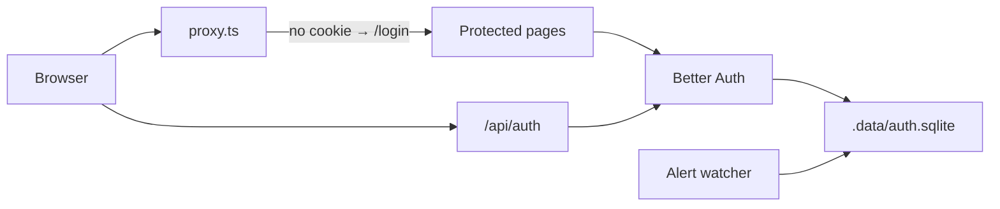

# Better Auth + SQLite — Implementation Plan

> **For agentic workers:** REQUIRED SUB-SKILL: Use superpowers:subagent-driven-development (recommended) or superpowers:executing-plans to implement this plan task-by-task. Steps use checkbox (`- [ ]`) syntax for tracking.

**Goal:** Trocar a auth caseira por Better Auth + SQLite em arquivo, proteger o app, e exibir nome+e-mail na navbar com o mínimo de código nosso.

**Architecture:** Better Auth com `better-sqlite3` em `web/.data/auth.sqlite` (sem Docker). Catch-all `/api/auth/[...all]`, Server Actions com `nextCookies()`, `proxy.ts` (Next 16) redireciona sem sessão. Alertas listam e-mails via query SQLite. Remover `password.ts` / `session.ts` / `users.ts` / `/login/sair`.

**Tech Stack:** Next.js 16.4.6 App Router, Better Auth, better-sqlite3, Vitest, TypeScript strict. Sem Prisma/Drizzle/Docker/OAuth.

**Spec:** [`docs/superpowers/specs/2026-11-14-better-auth-sqlite-design.md`](../specs/2026-11-14-better-auth-sqlite-design.md)

## Global Constraints

- Idioma: código `web/` em inglês; UI e docs em pt-BR.
- Camadas: `app → components → hooks → services → lib → types`; `components` e `hooks` nunca importam `services`.
- Todo arquivo em `services/**` começa com `import "server-only";`.
- Sem pasta nova de primeiro nível em `web/src` além de `test/`.
- Dashboard e `/api/stream` exigem sessão; públicos: `/login`, `/cadastro`, `/api/auth/*`.
- Só e-mail + senha + nome; sem OAuth, verificação de e-mail, reset, migração de `users.json`.
- Protótipo acadêmico: nenhum texto novo promete proteção real.
- Testes: Vitest `*.test.ts` em `web/src/test/`; sem Testing Library / jsdom novo.
- Verificar com `npm test`, `npm run lint` e `npm run build` em `web/`.
- Spec e este plano já existem no repo; não recriar. Commits frequentes por task.

## Review Focus

- Cookie forjado passa no `proxy` otimista → `getSessionUser()` na página deve `redirect("/login")`.
- SQLite / `.data/` inexistente na primeira subida → `mkdirSync` + migrate criam o arquivo; `listUserEmails` retorna `[]` sem crash.
- Cadastro sem nome ou senhas divergentes → erro em pt-BR, sem criar usuário.
- Alert watcher sem usuários → `console.info` skip, sem throw.
- Usuário logado em `/login` ou `/cadastro` → `redirect("/")`.

## File map

**Create**

- `web/src/services/auth/sqlite-path.ts` — path do `.data/auth.sqlite`
- `web/src/services/auth/auth.ts` — instância Better Auth
- `web/src/services/auth/get-session.ts` — `getSessionUser`
- `web/src/services/auth/list-user-emails.ts` — e-mails para alertas
- `web/src/lib/auth-proxy.ts` — `authProxyDecision` (puro, testável)
- `web/src/app/api/auth/[...all]/route.ts`
- `web/src/proxy.ts`
- testes em `web/src/test/...` espelhando os paths

**Modify**

- `web/package.json` — deps + script `auth:migrate`
- `web/next.config.ts` — `serverExternalPackages: ["better-sqlite3"]`
- `web/.env.example` — `BETTER_AUTH_*`; remover `AUTH_SECRET`
- `web/.gitignore` — comentário de `.data/` cita `auth.sqlite`
- `web/src/app/login/page.tsx`, `web/src/app/cadastro/page.tsx`
- `web/src/components/auth/auth-form.tsx` — campo nome no signup
- `web/src/components/auth/account-menu.tsx` — nome + e-mail + Sair
- `web/src/app/page.tsx`, `web/src/components/dashboard/dashboard.tsx`
- `web/src/services/alerts/alert-watcher.ts`
- `docs/decisions.md` (D21), `docs/architecture.md`, `docs/roadmap.md`
- `AGENTS.md` se ainda citar auth JSON / “sem login”

**Delete**

- `web/src/services/auth/password.ts`, `session.ts`, `users.ts`
- `web/src/app/login/sair/route.ts`
- `web/src/test/services/auth/password.test.ts`, `session.test.ts`, `users.test.ts`
- `web/src/test/app/login/sair/route.test.ts`



---

### Task 1: Decisão D21

**Files:**
- Modify: `docs/decisions.md` (append D21)
- Modify: `docs/architecture.md` (só se citar “sem login” / JSON auth — senão deixar para Task 9)

**Interfaces:**
- Produces: decisão D21 registrada (Better Auth + SQLite local; app exige login; sem Postgres/Docker)

- [ ] **Step 1: Append D21 em `docs/decisions.md`**

```markdown
## D21. Auth com Better Auth + SQLite local; app protegido

Login/cadastro usam Better Auth com `better-sqlite3` em `web/.data/auth.sqlite`. Não há Postgres nem Docker no protótipo. O dashboard e o SSE exigem sessão; `/login`, `/cadastro` e `/api/auth/*` são públicos. O cadastro pede nome; a navbar mostra nome e e-mail. Alertas leem e-mails do SQLite.
**Substitui** o trecho de D11 (“Sem banco, sem login…”) e a auth caseira JSON+HMAC da Etapa 5.
**Por quê:** menos código nosso, DX igual a um arquivo local, foco na lógica de produto.
**Alternativa descartada:** Postgres no Docker (processo extra); JSON caseiro (sessão/hash manuais); Better Auth sem proteger o app.
```

Também em D11, após a frase “Sem banco, sem login e sem estado global.”, acrescente: `(login/banco locais: ver D21).`

- [ ] **Step 2: Commit**

```bash
git add docs/decisions.md
git commit -m "$(cat <<'EOF'
docs: D21 Better Auth + SQLite e app protegido

EOF
)"
```

---

### Task 2: Dependências e config

**Files:**
- Modify: `web/package.json`
- Modify: `web/next.config.ts`
- Modify: `web/.env.example`
- Modify: `web/.gitignore`

- [ ] **Step 1: Instalar pacotes**

Run (em `web/`):

```bash
npm install better-auth better-sqlite3
npm install -D @types/better-sqlite3
```

- [ ] **Step 2: `next.config.ts`**

```ts
import type { NextConfig } from "next";

const nextConfig: NextConfig = {
  serverExternalPackages: ["better-sqlite3"],
  allowedDevOrigins: ["192.168.*.*", "10.*.*.*", "172.*.*.*"],
  turbopack: {
    rules: {
      "*.css": {
        loaders: ["@tailwindcss/turbopack"],
        as: "*.css",
      },
    },
  },
};

export default nextConfig;
```

- [ ] **Step 3: Substituir `web/.env.example` por**

```env
# Caminho do CSV gravado pela placa ou pelo mock (relativo à pasta web/)
DAILY_REPORT_PATH=../daily-report.csv
BETTER_AUTH_SECRET=
BETTER_AUTH_URL=http://localhost:3000
GMAIL_USER=
GMAIL_APP_PASSWORD=
ALERT_FROM_EMAIL=GasGuard <seu-email@gmail.com>
```

- [ ] **Step 4: Script e gitignore**

Em `web/package.json` `scripts`, adicionar:

```json
"auth:migrate": "npx @better-auth/cli@latest migrate --config src/services/auth/auth.ts"
```

Antes de commitar a Task 3, rode `npx @better-auth/cli@latest migrate --help` e ajuste a flag `--config` se a CLI usar outro nome (`-c`, path posicional, etc.).

Em `web/.gitignore`, trocar o comentário `# local prototype data (W5 users.json)` por `# local prototype data (auth.sqlite, etc.)`.

- [ ] **Step 5: Commit**

```bash
git add web/package.json web/package-lock.json web/next.config.ts web/.env.example web/.gitignore
git commit -m "$(cat <<'EOF'
chore(web): add better-auth and sqlite deps

EOF
)"
```

---

### Task 3: Instância Better Auth + route handler

**Files:**
- Create: `web/src/services/auth/sqlite-path.ts`
- Create: `web/src/services/auth/auth.ts`
- Create: `web/src/app/api/auth/[...all]/route.ts`

**Interfaces:**
- Produces:
  - `getAuthSqlitePath(): string`
  - `export const auth` (Better Auth instance)

- [ ] **Step 1: `sqlite-path.ts`**

```ts
import "server-only";

import { resolve } from "node:path";

export function getAuthSqlitePath(): string {
  return resolve(
    /* turbopackIgnore: true */ process.cwd(),
    process.env.AUTH_SQLITE_PATH ?? ".data/auth.sqlite",
  );
}
```

- [ ] **Step 2: `auth.ts`**

```ts
import "server-only";

import { betterAuth } from "better-auth";
import { nextCookies } from "better-auth/next-js";
import Database from "better-sqlite3";
import { mkdirSync } from "node:fs";
import { dirname } from "node:path";

import { getAuthSqlitePath } from "./sqlite-path";

const path = getAuthSqlitePath();
mkdirSync(dirname(path), { recursive: true });

export const auth = betterAuth({
  database: new Database(path),
  emailAndPassword: { enabled: true },
  plugins: [nextCookies()],
});
```

- [ ] **Step 3: Route handler**

```ts
import { toNextJsHandler } from "better-auth/next-js";

import { auth } from "@/services/auth/auth";

export const { GET, POST } = toNextJsHandler(auth);
```

- [ ] **Step 4: Migrate**

Garantir `web/.env` com `BETTER_AUTH_SECRET` (≥ 32 chars) e `BETTER_AUTH_URL=http://localhost:3000`. Depois:

```bash
cd web && npm run auth:migrate
```

Expected: tabelas `user`, `session`, `account`, `verification` no SQLite (não versionar o `.db`).

- [ ] **Step 5: Commit**

```bash
git add web/src/services/auth/sqlite-path.ts web/src/services/auth/auth.ts web/src/app/api/auth/\`\[...all\]\`/route.ts web/package.json
git commit -m "$(cat <<'EOF'
feat(web): wire Better Auth with SQLite

EOF
)"
```

---

### Task 4: `getSessionUser` + `listUserEmails` (TDD)

**Files:**
- Create: `web/src/services/auth/list-user-emails.ts`
- Create: `web/src/services/auth/get-session.ts`
- Test: `web/src/test/services/auth/list-user-emails.test.ts`
- Test: `web/src/test/services/auth/get-session.test.ts`

**Interfaces:**
- Consumes: `getAuthSqlitePath()`, `auth.api.getSession`
- Produces:
  - `listUserEmails(): string[]`
  - `getSessionUser(): Promise<{ name: string; email: string } | null>`

- [ ] **Step 1: Write failing tests for `listUserEmails`**

```ts
import { mkdtempSync, rmSync } from "node:fs";
import { tmpdir } from "node:os";
import { join } from "node:path";

import Database from "better-sqlite3";
import { afterEach, beforeEach, describe, expect, it } from "vitest";

describe("listUserEmails", () => {
  let dir: string;
  let dbPath: string;

  beforeEach(() => {
    dir = mkdtempSync(join(tmpdir(), "gg-auth-"));
    dbPath = join(dir, "auth.sqlite");
    process.env.AUTH_SQLITE_PATH = dbPath;
  });

  afterEach(() => {
    delete process.env.AUTH_SQLITE_PATH;
    rmSync(dir, { recursive: true, force: true });
  });

  it("returns [] when the database file is missing", async () => {
    const { listUserEmails } = await import("@/services/auth/list-user-emails");
    expect(listUserEmails()).toEqual([]);
  });

  it("returns emails from the user table", async () => {
    const db = new Database(dbPath);
    db.exec(
      `create table user (id text primary key, email text not null, name text);`,
    );
    db.prepare(`insert into user (id, email, name) values (?, ?, ?)`).run(
      "1",
      "ada@example.com",
      "Ada",
    );
    db.prepare(`insert into user (id, email, name) values (?, ?, ?)`).run(
      "2",
      "bob@example.com",
      "Bob",
    );
    db.close();

    const { listUserEmails } = await import("@/services/auth/list-user-emails");
    expect(listUserEmails().sort()).toEqual([
      "ada@example.com",
      "bob@example.com",
    ]);
  });
});
```

- [ ] **Step 2: Run test — expect FAIL**

```bash
cd web && npx vitest run src/test/services/auth/list-user-emails.test.ts
```

Expected: FAIL (módulo inexistente).

- [ ] **Step 3: Implement `list-user-emails.ts`**

```ts
import "server-only";

import Database from "better-sqlite3";

import { getAuthSqlitePath } from "./sqlite-path";

export function listUserEmails(): string[] {
  const db = new Database(getAuthSqlitePath(), {
    readonly: true,
    fileMustExist: false,
  });
  try {
    const rows = db.prepare("select email from user").all() as {
      email: string;
    }[];
    return rows.map((row) => row.email);
  } catch {
    return [];
  } finally {
    db.close();
  }
}
```

- [ ] **Step 4: Re-run list tests — PASS**

- [ ] **Step 5: Write failing tests for `getSessionUser`**

```ts
import { beforeEach, describe, expect, it, vi } from "vitest";

const getSession = vi.fn();

vi.mock("@/services/auth/auth", () => ({
  auth: { api: { getSession } },
}));

vi.mock("next/headers", () => ({
  headers: vi.fn(async () => new Headers()),
}));

describe("getSessionUser", () => {
  beforeEach(() => {
    getSession.mockReset();
  });

  it("returns null when there is no session", async () => {
    getSession.mockResolvedValue(null);
    const { getSessionUser } = await import("@/services/auth/get-session");
    expect(await getSessionUser()).toBeNull();
  });

  it("returns name and email from the session user", async () => {
    getSession.mockResolvedValue({
      user: { name: "Ada", email: "ada@example.com" },
    });
    const { getSessionUser } = await import("@/services/auth/get-session");
    expect(await getSessionUser()).toEqual({
      name: "Ada",
      email: "ada@example.com",
    });
  });
});
```

- [ ] **Step 6: Implement `get-session.ts`**

```ts
import "server-only";

import { headers } from "next/headers";

import { auth } from "./auth";

export async function getSessionUser(): Promise<{
  name: string;
  email: string;
} | null> {
  const session = await auth.api.getSession({ headers: await headers() });
  if (!session?.user?.email) return null;
  return { name: session.user.name, email: session.user.email };
}
```

- [ ] **Step 7: Run both test files — PASS; commit**

```bash
cd web && npx vitest run src/test/services/auth/list-user-emails.test.ts src/test/services/auth/get-session.test.ts
git add web/src/services/auth/list-user-emails.ts web/src/services/auth/get-session.ts web/src/test/services/auth/
git commit -m "$(cat <<'EOF'
feat(web): session helper and listUserEmails

EOF
)"
```

---

### Task 5: `proxy.ts` — app protegido

**Files:**
- Create: `web/src/lib/auth-proxy.ts`
- Create: `web/src/proxy.ts`
- Test: `web/src/test/lib/auth-proxy.test.ts`

**Interfaces:**
- Produces: `authProxyDecision(pathname: string, hasSessionCookie: boolean): "next" | { redirect: string }`

- [ ] **Step 1: Write failing tests**

```ts
import { describe, expect, it } from "vitest";

import { authProxyDecision } from "@/lib/auth-proxy";

describe("authProxyDecision", () => {
  it("sends guests on / to /login", () => {
    expect(authProxyDecision("/", false)).toEqual({ redirect: "/login" });
  });

  it("sends guests on /api/stream to /login", () => {
    expect(authProxyDecision("/api/stream", false)).toEqual({
      redirect: "/login",
    });
  });

  it("allows /login and /cadastro without a cookie", () => {
    expect(authProxyDecision("/login", false)).toBe("next");
    expect(authProxyDecision("/cadastro", false)).toBe("next");
  });

  it("always allows /api/auth/*", () => {
    expect(authProxyDecision("/api/auth/sign-in/email", false)).toBe("next");
    expect(authProxyDecision("/api/auth/get-session", true)).toBe("next");
  });

  it("allows protected routes when a cookie exists", () => {
    expect(authProxyDecision("/", true)).toBe("next");
    expect(authProxyDecision("/api/stream", true)).toBe("next");
  });

  it("sends signed-in users away from auth pages", () => {
    expect(authProxyDecision("/login", true)).toEqual({ redirect: "/" });
    expect(authProxyDecision("/cadastro", true)).toEqual({ redirect: "/" });
  });
});
```

- [ ] **Step 2: Run — expect FAIL; implement `auth-proxy.ts`**

```ts
export function authProxyDecision(
  pathname: string,
  hasSessionCookie: boolean,
): "next" | { redirect: string } {
  if (pathname.startsWith("/api/auth")) return "next";

  const isAuthPage = pathname === "/login" || pathname === "/cadastro";
  if (isAuthPage) {
    return hasSessionCookie ? { redirect: "/" } : "next";
  }

  if (!hasSessionCookie) return { redirect: "/login" };
  return "next";
}
```

- [ ] **Step 3: `proxy.ts`**

```ts
import { NextRequest, NextResponse } from "next/server";
import { getSessionCookie } from "better-auth/cookies";

import { authProxyDecision } from "@/lib/auth-proxy";

export function proxy(request: NextRequest) {
  const decision = authProxyDecision(
    request.nextUrl.pathname,
    Boolean(getSessionCookie(request)),
  );
  if (decision === "next") return NextResponse.next();
  return NextResponse.redirect(new URL(decision.redirect, request.url));
}

export const config = {
  matcher: [
    "/((?!_next/static|_next/image|favicon.ico|.*\\.(?:svg|png|jpg|jpeg|gif|webp)$).*)",
  ],
};
```

- [ ] **Step 4: Tests PASS; commit**

```bash
cd web && npx vitest run src/test/lib/auth-proxy.test.ts
git add web/src/lib/auth-proxy.ts web/src/proxy.ts web/src/test/lib/auth-proxy.test.ts
git commit -m "$(cat <<'EOF'
feat(web): protect app with proxy

EOF
)"
```

---

### Task 6: Login / cadastro via Better Auth + campo nome

**Files:**
- Modify: `web/src/components/auth/auth-form.tsx`
- Modify: `web/src/app/login/page.tsx`
- Modify: `web/src/app/cadastro/page.tsx`
- Test: `web/src/test/components/auth/auth-form.test.ts`
- Test: `web/src/test/app/login/page.test.ts`
- Test: `web/src/test/app/cadastro/page.test.ts`

**Interfaces:**
- Consumes: `auth.api.signInEmail`, `auth.api.signUpEmail`, `getSessionUser`
- Produces: Server Actions `login` / `signup` → `Promise<AuthFormState>`

- [ ] **Step 1: Update `authFormView` + test**

`authFormView("login")` inclui `showName: false`.  
`authFormView("signup")` inclui `showName: true`.

No JSX do signup, campo antes do e-mail:

```tsx
{view.showName ? (
  <label className="flex flex-col gap-1.5 text-sm">
    <span className="font-medium">Nome</span>
    <input
      id="name"
      name="name"
      type="text"
      autoComplete="name"
      required
      className={INPUT_CLASS}
    />
  </label>
) : null}
```

Atualizar `auth-form.test.ts` para assertar `showName`.

- [ ] **Step 2: `signup` action (em `cadastro/page.tsx`)**

Manter validação local: e-mail válido (regex simples ou helper puro em `lib/parse-email.ts` se quiser extrair), nome `trim()` não vazio → `"Informe o seu nome."`, senha `length < 8` → `"A senha deve ter pelo menos 8 caracteres."`, confirm mismatch → `"As senhas não coincidem."`.

Depois:

```ts
try {
  await auth.api.signUpEmail({
    body: { email, password, name: name.trim() },
    headers: await headers(),
  });
} catch {
  return { error: "E-mail já cadastrado." };
}
redirect("/");
```

(Se Better Auth devolver código distinguível de “duplicate” vs outro erro, mapear; senão a mensagem genérica de duplicata ou `"Não foi possível criar a conta."` para falha inesperada.)

- [ ] **Step 3: `login` action (em `login/page.tsx`)**

```ts
try {
  await auth.api.signInEmail({
    body: { email, password },
    headers: await headers(),
  });
} catch {
  return { error: "E-mail ou senha inválidos." };
}
redirect("/");
```

- [ ] **Step 4: Páginas**

No topo de LoginPage e SignupPage:

```ts
const user = await getSessionUser();
if (user) redirect("/");
```

Remover imports da auth caseira (`verifyPassword`, `findUser`, `createUser`, `setSession`, `passwordError`).

- [ ] **Step 5: Reescrever testes das pages** com `vi.mock("@/services/auth/auth")` e `vi.mock("@/services/auth/get-session")`. Não tocar disco JSON. Cobrir: validação local; sucesso chama API e redireciona (mock `redirect` throw como hoje); API falha → erro pt-BR.

- [ ] **Step 6: Commit**

```bash
git add web/src/components/auth/auth-form.tsx web/src/app/login/page.tsx web/src/app/cadastro/page.tsx web/src/test/components/auth/auth-form.test.ts web/src/test/app/login/page.test.ts web/src/test/app/cadastro/page.test.ts
git commit -m "$(cat <<'EOF'
feat(web): login and signup via Better Auth

EOF
)"
```

---

### Task 7: Navbar nome+e-mail + logout + home

**Files:**
- Modify: `web/src/components/auth/account-menu.tsx`
- Modify: `web/src/components/dashboard/dashboard.tsx`
- Modify: `web/src/app/page.tsx`
- Create: Server Action de logout (ex.: `web/src/app/login/actions.ts` ou inline no menu via prop `action`)
- Delete: `web/src/app/login/sair/route.ts` + `web/src/test/app/login/sair/route.test.ts`
- Test: `web/src/test/components/auth/account-menu.test.ts`
- Test: `web/src/test/app/page.test.ts`

**Interfaces:**
- `accountMenuView(user: { name: string; email: string })`
- `AccountMenu({ user: { name: string; email: string }; signOutAction: ... })`
- `Dashboard({ initial, user: { name: string; email: string } })`
- `signOut(): Promise<void>` → `auth.api.signOut` + `redirect("/login")`

- [ ] **Step 1: `accountMenuView` — só signed-in**

```ts
export function accountMenuView(user: { name: string; email: string }) {
  return {
    name: user.name,
    email: user.email,
    logoutLabel: "Sair" as const,
  };
}
```

UI: `<span>{view.name}</span>` + `<span className="text-muted-foreground">{view.email}</span>` + `<form action={signOutAction}>`. Remover estado guest e links Entrar/Cadastrar.

Teste: asserta name, email, logoutLabel; sem `loginHref`.

- [ ] **Step 2: `signOut` Server Action**

```ts
"use server";

import { headers } from "next/headers";
import { redirect } from "next/navigation";

import { auth } from "@/services/auth/auth";

export async function signOut() {
  await auth.api.signOut({ headers: await headers() });
  redirect("/login");
}
```

- [ ] **Step 3: `page.tsx`**

```ts
import { connection } from "next/server";
import { redirect } from "next/navigation";

import { Dashboard } from "@/components/dashboard/dashboard";
import { getSessionUser } from "@/services/auth/get-session";
import { getRecentReadings } from "@/services/report/report-service";

export default async function Home() {
  await connection();
  const user = await getSessionUser();
  if (!user) redirect("/login");
  const initial = await getRecentReadings();
  return <Dashboard initial={initial} user={user} />;
}
```

- [ ] **Step 4: Atualizar Dashboard props e testes de `page` (mock `getSessionUser`; se null, espera redirect).** Apagar `/login/sair`.

- [ ] **Step 5: Commit**

```bash
git add web/src/components/auth/account-menu.tsx web/src/components/dashboard/dashboard.tsx web/src/app/page.tsx web/src/app/login/ web/src/test/
git commit -m "$(cat <<'EOF'
feat(web): show name and email in account menu

EOF
)"
```

---

### Task 8: Alert watcher + remoção da auth caseira

**Files:**
- Modify: `web/src/services/alerts/alert-watcher.ts`
- Modify: `web/src/test/services/alerts/alert-watcher.test.ts`
- Delete: `password.ts`, `session.ts`, `users.ts` + testes

**Interfaces:**
- Consumes: `listUserEmails(): string[]`
- `handleCriticalReading` continua aceitando `users: { email: string }[]` **ou** muda para `emails: string[]` — escolher uma e atualizar testes; recomendação: manter `{ email }[]` com `.map((email) => ({ email }))` para diff mínimo.

- [ ] **Step 1: Em `startAlertWatcher`**

```ts
import { listUserEmails } from "@/services/auth/list-user-emails";
// ...
users: listUserEmails().map((email) => ({ email })),
```

Mock nos testes: `vi.mock("@/services/auth/list-user-emails", () => ({ listUserEmails: vi.fn(() => []) }))`.

- [ ] **Step 2: Apagar auth caseira e imports órfãos**

Remover ficheiros listados no File map Delete. Grep por `services/auth/users`, `services/auth/session`, `services/auth/password`, `/login/sair`, `AUTH_SECRET`, `users.json` e limpar.

- [ ] **Step 3: `npm test` — PASS**

```bash
cd web && npm test
```

- [ ] **Step 4: Commit**

```bash
git add -A web/src web/src/test
git commit -m "$(cat <<'EOF'
refactor(web): alerts use SQLite emails; remove homemade auth

EOF
)"
```

---

### Task 9: Docs de arquitetura + verificação final

**Files:**
- Modify: `docs/architecture.md`, `docs/roadmap.md`, `AGENTS.md` (se citarem JSON auth / “sem login”)

- [ ] **Step 1: Architecture** — mencionar Better Auth, SQLite em `.data/auth.sqlite`, `proxy.ts`, app protegido; alertas leem e-mails do SQLite.

- [ ] **Step 2: Roadmap Etapa 5** — marcar login/cadastro como Better Auth + SQLite; manter e-mail Gmail como está.

- [ ] **Step 3: Verificação**

```bash
cd web && npm test && npm run lint && npm run build
```

Expected: tudo PASS / exit 0.

- [ ] **Step 4: Smoke manual**

1. `npm run dev` em `web/`
2. Abrir `/` → redirect `/login`
3. Ir a `/cadastro`, criar conta com nome
4. Navbar mostra nome + e-mail
5. Sair → `/login`
6. Entrar de novo → dashboard

- [ ] **Step 5: Commit**

```bash
git add docs/architecture.md docs/roadmap.md AGENTS.md
git commit -m "$(cat <<'EOF'
docs: Better Auth architecture and roadmap

EOF
)"
```

---

## Self-review (plan vs spec)

1. **Spec coverage:** SQLite local, app protegido, nome+e-mail, alertas, remoção caseira, docs — Tasks 1–9.
2. **Placeholders:** nenhum TBD; código e comandos concretos nas steps.
3. **Types:** `getSessionUser` → `{ name, email } | null`; `listUserEmails` → `string[]`; `authProxyDecision` → `"next" | { redirect: string }`; Dashboard `user: { name, email }`.
4. **Review Focus:** cookie forjado → Task 7 `getSessionUser`; SQLite ausente → Task 4 `[]`; validação cadastro → Task 6; alertas vazios → Task 8; logado em auth pages → Tasks 5–6.
